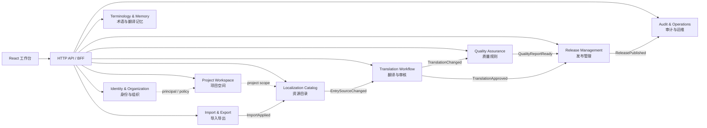
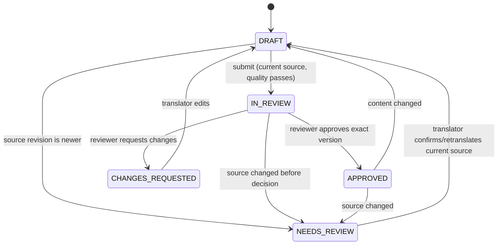
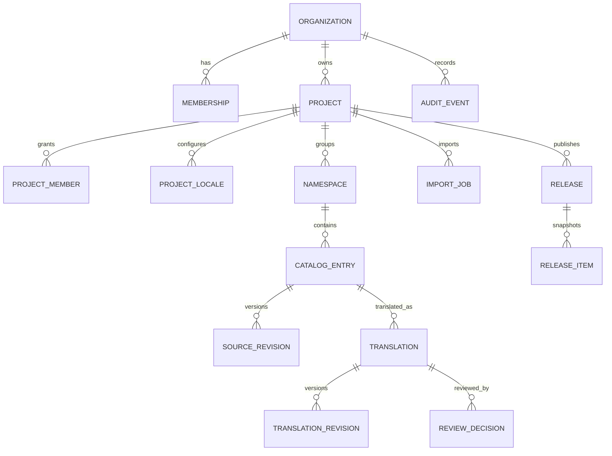

# 言渡 YANDU 服务端 DDD 技术设计

版本：0.3（实现对齐版；未决产品规则见第 13 节） · 2026-10-25
关联规格：[spec 003](../specs/003-backend-collaboration.md) · 关联计划：[plan 003](../plans/003-backend-collaboration.md)
范围来源：关联对话要求排除截图翻译，为其它翻译管理功能形成含后台原型的详细设计，并以可扩展架构为目标。工程实现采用 Spring Boot、Spring Modulith、MyBatis-Plus、MySQL 8.0 和数字 BIGINT ID。

## 1. 目标和决策边界

设计一套可逐步上线的商业翻译管理平台，支持项目/资源管理、翻译与审核、质量检查、异步导入、发布与回溯。前端保留当前 React + TypeScript 工作台，通过数据访问端口从本地模式迁移到真实 API。本文定义后端领域边界、关键规则、持久化和接口草案，不宣称相关功能已经实现。

### 本期实现约束（优先于本文中的扩展设计）

- 持久化目标为 MySQL 8.0，ORM/SQL 工具为 MyBatis-Plus；ID 使用应用生成的数字 BIGINT，API 以十进制字符串传递。
- 本期不实现 Organization、组织成员、租户列、租户拦截器或跨组织隔离；访问边界是项目成员与项目角色。本文 4.1、6.2 中的组织/租户设计仅作未来扩展参考，不得作为当前实现要求。
- 本期不实现 Outbox；强一致的跨模块操作通过同一数据库事务中的本地应用服务调用完成。
- 按用户要求优先沿现有模块扩展，不为小操作拆成大量 Java 类或独立测试类；一个业务大模块完成后集中验证。
- Java 框架和本设计已作为当前工程基线；OIDC 提供方、具体角色权限规则以及发布细节仍需按产品部署决定。

### 1.1 推荐方案

| 领域 | 推荐 | 说明/确认状态 |
| --- | --- | --- |
| 语言及运行时 | Java 21 LTS；Spring Boot 当前稳定维护线 | 当前工程基线为 Java 21 / Spring Boot 3.5 / Spring Modulith 1.4。 |
| 结构 | DDD 分层模块化单体；Spring Modulith 用于模块边界验证和文档生成 | 以一个可部署应用和 MySQL 8.0 启动；不先拆微服务。 |
| HTTP 安全 | Spring Security；OIDC 身份认证，领域应用服务执行项目成员/资源授权 | OIDC 提供者和 token 校验参数由部署环境配置。URL 级授权不能代替资源级授权。 |
| 数据库 | MySQL 8.0 | 用户确认 MySQL 8.0 或具备切换至 MySQL 8.0 的能力。保留持久化边界和可移植 SQL；未指定并实测第二数据库前不宣称双数据库支持。对象存储仅承载大文件/生成包。 |
| API | `/api/v1` REST/JSON + OpenAPI | 同步命令用于小型事务；大文件解析、批量导入和资源构建使用异步任务。 |
| 数据访问 | MyBatis-Plus | Mapper 只存在于 infrastructure；领域聚合不继承 Active Record，不暴露 ORM 懒加载。复杂列表可使用专用查询 Mapper/投影。 |
| 主键 | 数字 `BIGINT`，应用生成，API 将 ID 编码为十进制字符串 | 用户明确不采用 UUID；当前实现使用 Snowflake，避免依赖数据库自增。上线多实例前固定并验证 worker/node ID 配置。 |
| 迁移 | Flyway 版本化迁移 | MySQL 主方言脚本单独维护；保持通用列类型、应用生成 ID 和可移植约束。若增加第二种数据库，增加独立方言迁移并运行双数据库集成契约。 |
| 异步 | 导入/发布用业务任务表和 worker；本期不引入 Outbox | 源词条等同步领域变更通过同一事务内的本地模块调用完成；以后若需要跨进程可靠事件，再单独评审 Outbox。 |

### 实现粒度

DDD 模块是业务边界，不要求每个名词、命令或查询都拆成独立 Java 文件。沿用同一模块内现有应用服务、Mapper 和响应记录；只有需要独立生命周期、规则或复用边界时才拆类型。MyBatis-Plus 行映射保留必要的实体类型，轻量查询投影可复用已有行类型或模块内记录。按用户要求，在完成一个业务大模块后集中运行现有测试套件；不为每个小方法创建 `Test` 类，也不因添加简单字段就重复跑完整测试。

Catalog 的源词条与术语有不同生命周期，因此应用端口分别表达词条存取和 `GlossaryTerms` 用例；MyBatis 适配器可以实现这两个端口，避免为单一适配器再新增实现类或文件。分页搜索与总数、工作台列表与统计按一次应用查询用例组合返回，Repository 不逐条暴露底层 `count` 查询。

选择模块化单体是为当前团队和产品阶段降低运维成本，同时让领域模块具备边界清晰的 API。Spring Modulith 支持 Spring Boot 应用模块的结构验证、文档和模块集成测试；采用它不等于要采用事件驱动的所有机制。[Spring Modulith Fundamentals](https://docs.spring.io/spring-modulith/reference/fundamentals.html)

MyBatis-Plus 提供 tenant、乐观锁、分页和全表更新/删除保护等插件；本方案使用它们减少遗漏，但所有资源访问仍必须由应用服务执行授权。官方文档明确区分多租户隔离与业务权限过滤，且自定义 SQL/Join 必须符合租户插件的解析约束。[MyBatis-Plus 多租户插件](https://baomidou.com/plugins/tenant/)、[MyBatis-Plus 插件核心](https://baomidou.com/plugins/)

Spring Security 在 HTTP 请求和方法调用两层都可做授权；本设计将认证身份映射为用户主体，再由应用服务对组织、项目、角色和资源执行授权判断。[Spring Security Authorization](https://docs.spring.io/spring-security/reference/servlet/authorization/index.html)

## 2. 产品子域与限界上下文



| 限界上下文 | 核心职责 | 拥有数据 | 对外契约 |
| --- | --- | --- | --- |
| Identity & Organization | 用户身份关联、组织、成员邀请/退出、组织角色 | `users`、`organizations`、`memberships`、邀请记录 | 当前主体、组织成员变更事件 |
| Project Workspace | 项目生命周期、语言配置、项目成员授权、命名空间 | `projects`、`project_locales`、`project_members`、`namespaces` | 项目摘要、项目授权决策、项目配置事件 |
| Localization Catalog | 稳定 key、源文本版本、条目归档、资源结构 | `catalog_entries`、`source_revisions` | 词条查询投影、`EntrySourceChanged` |
| Translation Workflow | 单语言译文、草稿/审核状态、乐观锁、审核历史 | `translations`、`translation_revisions`、`review_decisions` | 保存/送审/批准/退回命令，翻译事件 |
| Quality Assurance | 必填、占位符一致、格式约束与质量报告 | 规则配置、可重建质量报告 | 同步校验 API、异步批量校验、门禁判定 |
| Terminology & Memory | 术语、翻译记忆条目与建议 | `glossary_terms`、`translation_memory` | 权限过滤后的只读建议 API |
| Import & Export | 文件解析、预览差异、幂等导入、导出任务 | `import_jobs`、`import_rows`、`export_jobs`、对象引用 | 任务状态 API、应用结果事件、临时下载地址 |
| Release Management | 发布门禁、不可变资源包、回滚编排 | `releases`、`release_artifacts`、清单/校验和 | 创建、下载、回滚命令，发布事件 |
| Audit & Operations | 安全相关审计、健康、任务可观测性 | `audit_events`、操作失败分类、运维指标 | 审计查询和运维只读接口 |

**上下文映射：** IAM 是认证主体与组织成员的上游；Workspace 是项目级授权和范围的上游。Catalog 拥有源词条；Translation 拥有译文和审核状态。Quality 读取当前源/译文版本并产生带版本号的报告。Release 只从明确版本和质量报告构建快照。Import/Export 通过公开的应用命令调用拥有者，不直接写入其他上下文的表。

## 3. DDD 分层和代码布局

```text
com.yandu
├── identity                 # 用户主体、认证适配和 token 映射
├── organization             # 组织、成员与邀请
├── workspace                # 项目、语言、项目角色
├── catalog                  # namespace、catalog entry、源版本
├── translation              # translation 聚合、草稿、审核与并发控制
├── quality                  # 规则、占位符分析、质量报告
├── terminology              # glossary 与 translation memory
├── transfer                 # import/export job、JSON/Properties codec
├── release                  # 发布门禁、快照、包、回滚
├── audit                    # 审计与审计查询
└── shared                   # 极少量稳定的 ID、时钟、分页、错误类型
```

每个业务模块内部采用纵向组织：

```text
translation/
  api/                       # 允许其他模块调用的命令/查询接口和事件
  application/               # 用例编排、事务边界、授权策略调用
  domain/                    # 聚合、实体、值对象、领域服务、领域事件
  infrastructure/            # MyBatis-Plus Mapper、DO/Entity 映射、外部适配器
  web/                       # Controller、DTO 与 API 错误映射
```

依赖规则：`web → application → domain`；`infrastructure → application/domain` 实现端口；domain 不依赖 Spring、HTTP、MyBatis-Plus、数据库、文件系统或外部厂商 SDK。其他模块仅依赖模块 `api` 包或调用公开用例接口，不能访问内部 Mapper/表。用 Spring Modulith 的 `ApplicationModules` 结构验证阻止非法包依赖，并产出模块图。源文变更需要更新译文复核状态时，由 Catalog 应用服务在同一个数据库事务内调用 Translation 模块公开用例；本期不做 Outbox，也不把这类强一致规则异步化。

持久化可替换边界：每个模块的 Repository 端口由 MyBatis-Plus 实现，Mapper SQL、DO 与 Flyway schema 脚本留在 `infrastructure/persistence/mysql`。实体主键使用应用生成的正整数 `BIGINT` 雪花 ID，不依赖 `AUTO_INCREMENT`；领域层只依赖 ID 值，不调用 MyBatis-Plus ID API。MyBatis-Plus `ASSIGN_ID` 使用 `IdentifierGenerator`，上线多实例前需配置并验证节点 ID，避免 worker 冲突。JSON API 将 `BIGINT` ID 序列化为十进制字符串，避免 JavaScript `Number` 精度丢失。时间统一 UTC；避免业务 SQL 依赖 MySQL 专有函数、隐式类型转换、JSON 查询语法或自动更新时间。数据库特有分页、全文检索等封装为 adapter capability，不能泄漏到领域规则。切换数据库仍需新增方言迁移、驱动、SQL adapter 和完整持久化契约验证，不能仅替换 JDBC URL。

## 4. 聚合、值对象与不变量

### 4.1 Organization 与 Membership

Organization 聚合只承载组织名称、状态、套餐策略占位（首期不计费）和管理操作；成员关系是单独的 Membership 聚合，以避免成员列表无限增长。

- `OrganizationId`、`UserId`、`MembershipId` 是强类型 ID。
- `(organization_id, user_id)` 唯一；成员状态为 `INVITED | ACTIVE | SUSPENDED | LEFT`。
- 组织最后一个 ACTIVE Owner 不能被降级/移除；Owner 交接需同事务产生审计事件。
- 组织角色只表明组织级管理能力；它不会自动授予每个项目的所有读写能力（Owner/Admin 的默认项目策略需产品决策确认）。

### 4.2 Project 与 ProjectLocale

Project 聚合管理名称、描述、源语言、生命周期、配置版本。项目语言配置同项目事务更新，采用 `project_locales` 表，不把所有资源载入聚合。

- `sourceLocale` 必须唯一且不在目标语言集合；至少一目标语言是否为创建必需项待确认。
- 项目 slug/key 规则和归档策略需明确定义；归档项目只读，恢复需要项目管理员权限。
- `(organization_id, project_id)` 资源引用必须一致；业务读取总带组织/项目约束。
- 项目成员角色建议 `PROJECT_ADMIN | TRANSLATOR | REVIEWER | VIEWER`，角色作用域先按项目；用户可同时具有译员与审校员身份，但是否能自审由策略明确禁止。

### 4.3 CatalogEntry（源词条）

```text
CatalogEntry
  id: EntryId
  projectId: ProjectId
  namespaceId: NamespaceId
  key: ResourceKey
  sourceLocale: Locale
  currentSource: SourceText
  sourceRevision: PositiveLong
  lifecycle: ACTIVE | ARCHIVED
```

不变量：`(project_id, namespace_id, canonical_key)` 唯一；同一修改命令中源文本不变则不增加 revision；有变化则 `sourceRevision + 1` 并追加 SourceRevision 记录。翻译模块落地后，源文本修改和全部活动目标译文标记 `NEEDS_REVIEW` 在同一数据库事务内完成；即使当前使用本地模块调用，也要由“源版本落后即禁止审核/发布”的读时检查兜底。

### 4.4 Translation（每个条目、目标语言一个聚合）

聚合身份为 `(entry_id, locale)`，与源 Entry 分离，避免编辑同一个条目的不同语言互相锁定。

```text
Translation
  entryId, locale
  value: TranslationText
  status: DRAFT | IN_REVIEW | APPROVED | CHANGES_REQUESTED | NEEDS_REVIEW
  basedOnSourceRevision: PositiveLong
  version: PositiveLong            # optimistic lock
  updatedBy, updatedAt
  latestDecisionId?
```

- 保存命令携带 `expectedVersion`。更新 where `version = expectedVersion`；影响行数为 0 时返回 `TRANSLATION_VERSION_CONFLICT`。不得 Last-Write-Wins。
- 保存内容与当前 value 相同为幂等 no-op，不生成重复 revision 或审计噪声。
- 值变化时生成 `TranslationRevision`、增加 version；如原状态为 APPROVED 则变为 DRAFT；如 `basedOnSourceRevision < current sourceRevision` 则保持 NEEDS_REVIEW，必须显式确认基于新源文翻译后才能送审。
- `SubmitForReview` 要求非空译文、无阻断质量错误、译文基于当前源版本；转 `IN_REVIEW`。
- `Approve` 只允许 Reviewer/Admin 权限；禁止原译者自审；决策绑定精确 `translation.version` 和 `sourceRevision`。提交或批准后内容变动，则批准对新版本无效。
- `RequestChanges` 需要原因并绑定版本；旧决定保留。撤回需单独 `WithdrawReviewDecision` 命令、权限和审计理由，不删除历史。

### 4.5 ImportJob、Release

ImportJob 和 Release 都是独立聚合，不放在 Project 聚合中。

- Import 状态：`UPLOADED → PARSING → PREVIEW_READY → APPLYING → COMPLETED`；可转 `FAILED` 或 `CANCELLED`。`APPLYING` 只能应用用户确认的预览哈希；保存 `idempotency_key`，唯一约束 `(organization_id, idempotency_key)`。
- Release 状态：`BUILDING → READY → PUBLISHED`；失败可 `FAILED`。已发布版本不更新、不覆盖。创建新发布用于“回滚”，其 manifest 引用/复制旧资源版本并标注 `rollback_of_release_id`。
- 发布 manifest 固定 locale、key、源版本、译文 revision、quality report revision、格式和导出器版本，生成 SHA-256 校验和。仅保存 manifest 的不可变文件对象 key，不接受覆盖写。

## 5. 状态机和业务流程



产品规则补充：保存一个基于最新源文的修改后，状态回到 DRAFT。`NEEDS_REVIEW` 表示旧译文基于较早源版本，不应仅通过查看就自动被视为当前稿；编辑/显式确认新源文后才回 DRAFT。任何批准命令会再次读取 Catalog 的当前 `sourceRevision`，避免事件处理延迟导致过期内容被批准。

### 5.1 编辑源条目

```mermaid
sequenceDiagram
  actor Editor
  participant API
  participant Access as AccessPolicy
  participant Catalog
  participant DB
  Editor->>API: UpdateSource(expectedRevision, text)
  API->>Access: authorize(org, project, EDIT_SOURCE)
  API->>Catalog: changeSource(...)
  Catalog->>DB: lock/check revision; insert source_revision; update entry
  Note over API,DB: 翻译模块接入后，在本事务内调用其公开用例更新待复核状态
  DB-->>API: commit transaction
  API-->>Editor: new sourceRevision
```

### 5.2 导入 JSON

1. API 校验文件大小、编码、扩展名和操作者导入权限，上传到隔离存储，创建任务及幂等键并立即返回 `202 + jobId`。
2. Worker 流式解析；拒绝重复 key、危险路径段、非字符串叶节点/超深嵌套（首期 JSON 正式范围需确认），收集行号和错误。
3. 任务生成只读 Preview，包含新增/修改/保持/冲突/无效统计和最多分页浏览的差异明细；预览绑定输入文件摘要、项目配置版本和解析器版本。
4. 用户确认 Preview 时必须传 `previewHash`；如项目配置或条目版本变化，返回 `IMPORT_PREVIEW_STALE` 要求重算。
5. Apply 用固定大小分批，写入事务和导入行结果；失败时按已确认的原子性策略整体回滚或报告可重试批次。推荐每个 namespace+locale 的确认应用批次事务化，不允许“成功”状态掩盖部分失败。
6. 幂等键保证重复请求返回同一任务。任务状态、重试次数、错误摘要和审计事件可查询。

### 5.3 审核、质量和发布

质量 API 对当前 sourceRevision/value/version 计算结构化问题：`ruleId/severity/locale/entryId/key/location/message/expected/actual`。占位符识别器首期明确支持的语法必须在格式规格定义，不以正则猜测所有模板类型。

发布命令带 `projectId + locale(s) + format + expectedCatalogRevision + idempotencyKey`。Release 应用服务校验：操作者权限、词条覆盖策略、无处于过期源版本的已批准译文、当前版本全部通过 blocker 质量规则，然后创建快照任务。Worker 写临时对象，校验解析/序列化 fixtures、计算 checksum，最后以不可变 artifact key 标记 READY/PUBLISHED。下载每次重新验证当前访问权限并审计，不把永久公开的对象 URL 暴露给未授权用户。

## 6. 授权和租户隔离

### 6.1 授权计算

```text
Decision = authenticated principal
         + active OrganizationMembership
         + ProjectMembership/OrganizationAdmin policy
         + action permission
         + resource organization_id/project_id match
         + resource lifecycle / workflow condition
```

角色只是权限集合的输入，资源 scope 才决定访问边界。所有业务用例经过 `AccessPolicy` / `AuthorizationService`；控制器 request matcher 检查“是否登录/是否开放”，应用服务再检验具体资源。禁止只写 `hasRole('ADMIN')` 就认为已做租户隔离。

### 6.2 组织/租户数据面防线（未来扩展，本期不实现）

- 主表含 `organization_id`，项目内对象也含/可索引 `project_id`；数据库唯一键带组织或项目 scope，例如 `(organization_id, project_id, namespace_id, normalized_key)`。
- Repository 必须接收 `OrganizationId` 和资源 ID，不暴露不带租户范围的公共 `findById(id)`。下载、异步 worker、审计查询也传入原始租户范围。
- MySQL 8.0 不提供 PostgreSQL 风格的通用行级安全策略。本方案不假设数据库会自动隔离每行；MyBatis-Plus `TenantLineInnerInterceptor` 作为 SQL 过滤防线，tenant ID 只能来自可信认证上下文，不能从请求体直读。所有 Mapper 自定义 SQL、JOIN、批量操作、租户豁免表、后台任务和 migration 操作都要有专项审查与跨租户测试。租户插件不能替代 `AccessPolicy`，也不能证明同组织内的项目角色授权。
- 永不信任请求中的组织 ID：从认证主体解析可用组织，再验证资源归属；跨组织资源错误统一返回 404，避免枚举。
- 组织边界的集成测试必须覆盖 list/get/create/update/delete/export/history/task/artifact 全部读写入口及异步执行。

### 6.3 默认权限矩阵草案

| 能力 | Org Owner/Admin | Project Admin | Translator | Reviewer | Viewer |
| --- | --- | --- | --- | --- | --- |
| 管理组织成员 | 是 | 否 | 否 | 否 | 否 |
| 项目/语言设置 | 是（策略待定） | 是 | 否 | 否 | 否 |
| 读词条/译文 | 是 | 是 | 是 | 是 | 是 |
| 修改源文本/导入 | 是（策略待定） | 是 | 否 | 否 | 否 |
| 编辑译文 | 可配置 | 可配置 | 是 | 可配置 | 否 |
| 送审 | 可配置 | 可配置 | 是（自己的译文） | 可配置 | 否 |
| 审核他人译文 | 可配置（须理由） | 可配置（须理由） | 否 | 是 | 否 |
| 发布/回滚/下载历史包 | 可配置 | 是 | 否 | 可配置 | 否 |
| 查看审计日志 | 是（组织级） | 是（项目级） | 否 | 否 | 否 |

此表是需要产品确认的草案；实现前要拆分权限码，并明确组织管理员是否默认拥有项目数据访问权、导出权和审计查看权。

## 7. 持久化逻辑模型

数据库用关系表表达强一致业务状态；大文件和构建产物放对象存储，数据库保存不可变 key、摘要和权限范围。为保留数据库切换能力，主数据尽量只用常见的整数/字符串/时间/二进制/文本类型，不依赖 JSON 字段查询、数据库触发器或厂商锁定特性；配置与报告 JSON 作为序列化文本存储，或放入可替换的 JSON adapter。ID 由应用生成，主从迁移脚本和索引语法按数据库方言隔离。



关键表及约束：

| 表 | 关键列/约束 |
| --- | --- |
| `organizations` | `id`, `status`, `created_at`; 名称在组织内无需唯一，可选 slug 全局唯一 |
| `memberships` | `organization_id`, `user_id`, `role`, `status`, `version`; unique `(organization_id,user_id)` |
| `projects` | `id`, `organization_id`, `name`, `source_locale`, `status`, `version`; 索引 `(organization_id,status,updated_at)` |
| `project_members` | unique `(project_id,user_id)`；角色字段或多角色关联表按确认矩阵选择 |
| `project_locales` | unique `(project_id,locale)`、check locale != source locale |
| `namespaces` | `project_id`, `path`, `status`; unique `(project_id,path)` |
| `catalog_entries` | 当前实现：`id BIGINT`, `project_id BIGINT`, `namespace_id BIGINT`, `entry_key`, `source_text`, `source_revision`, `version`; unique `(project_id,namespace_id,entry_key)`；组织字段和租户拦截留待后续阶段；MySQL 8 用源文前缀索引筛选翻译记忆候选后再做完整等值校验 |
| `source_revisions` | entry/sourceRevision 唯一；记录变更者、文本、时间、来源命令 |
| `translations` | `organization_id`, `project_id`, `entry_id`, `locale`, `value`, `status`, `based_on_source_revision`, `version`; unique `(entry_id,locale)` |
| `translation_revisions` | unique `(translation_id,version)`；保存内容快照/差异、操作者、命令 ID |
| `review_decisions` | translation/version/sourceRevision、reviewer、decision、reason、时间；不可 update/delete |
| `quality_reports` | 输入版本三元组、ruleSetVersion、status、序列化问题文本；索引版本列，旧报告不可误用于新版本 |
| `import_jobs` | tenant/project、idempotency key、state、previewHash、fileDigest、progress、retry count |
| `import_rows` | job、行号、key、action、errors、apply result；按 job 分页 |
| `releases` | tenant/project、locale/format、状态、manifest、checksum、artifact key、rollback reference |
| `audit_events` | tenant/project、actor、action、resource type/id、correlation ID、safe metadata、time；append-only |

金额/计费不在首期，不能为了未来账单先增加不必要的 billing schema。软删除仅用于支持恢复的资源并保留审计；隐私删除规则需结合身份提供方和数据保留策略确定。

## 8. API 草案

所有资源都从认证上下文确定组织范围；`organizationId` 可做路由上下文但必须与主体成员校验。列表默认 page size 50、最大 200；大列表使用稳定游标 `(updated_at,id)`。所有错误包含 `code`, `message`, `correlationId`, 可选 `details[]`，不回显内部 SQL/栈。

| 方法/路径 | 用例 | 并发/幂等 |
| --- | --- | --- |
| `GET /api/v1/me/organizations` | 当前用户组织列表 | — |
| `GET/POST /api/v1/organizations/{orgId}/projects` | 项目列表/创建 | 创建可选 idempotency key |
| `GET/PATCH /api/v1/projects/{projectId}` | 项目详情/改名、语言配置 | PATCH 带 `If-Match` 或 body version |
| `GET/POST /api/v1/projects/{projectId}/entries` | 搜索/创建条目 | 创建 key 唯一约束 |
| `PATCH /api/v1/projects/{projectId}/entries/{entryId}/source` | 修改源文并使旧翻译待复核 | `expectedSourceRevision` |
| `GET /api/v1/projects/{projectId}/translations` | 按 locale/status/key 搜索、游标分页 | read model |
| `PUT /api/v1/projects/{projectId}/entries/{entryId}/translations/{locale}` | 保存译文 | `expectedVersion`; 冲突 409 |
| `POST .../translations/{locale}/submit-review` | 送审 | `expectedVersion` |
| `POST .../translations/{locale}/decisions` | 批准/退回 | 决策版本必须匹配；幂等 command id |
| `POST /api/v1/projects/{projectId}/quality/check` | 单条同步检查或批量任务 | 大批返回 202 job |
| `POST /api/v1/projects/{projectId}/imports` | 上传并解析 | `Idempotency-Key`; 202 |
| `GET /api/v1/import-jobs/{jobId}` | 查看任务和预览分页 | 请求时重新授权 |
| `POST /api/v1/import-jobs/{jobId}/apply` | 应用预览 | 必传 `previewHash` 和幂等键 |
| `POST /api/v1/projects/{projectId}/releases` | 检查门禁并生成发布 | 202; 固定目标版本/格式 |
| `GET /api/v1/releases/{releaseId}` | 查看不可变发布及质量证据 | 重新授权 |
| `GET /api/v1/releases/{releaseId}/artifact` | 下载发布包 | 短时、单次或受控下载链接 |
| `POST /api/v1/releases/{releaseId}/rollback` | 创建指向旧快照的新发布 | 新 release id，不篡改历史 |
| `GET /api/v1/projects/{projectId}/audit-events` | 按资源/操作者/时间查审计 | 游标；审计查看权限 |

### 8.1 错误码样例

| HTTP | `code` | UI 行为 |
| --- | --- | --- |
| 401 | `AUTHENTICATION_REQUIRED` | 进入登录/恢复登录态 |
| 403 | `ACTION_NOT_ALLOWED` | 显示权限说明，不重试同一命令 |
| 404 | `RESOURCE_NOT_FOUND` | 资源不存在或当前主体不可见时使用统一响应 |
| 409 | `TRANSLATION_VERSION_CONFLICT` | 保留本地草稿，展示服务器版本和差异，允许复制/合并 |
| 409 | `IMPORT_PREVIEW_STALE` | 保留上传文件，重跑预览并显示变化 |
| 422 | `QUALITY_GATE_FAILED` | 展示 blocker 的词条/语言定位，提供回到编辑动作 |
| 413 | `UPLOAD_TOO_LARGE` | 显示当前限制与可导出的恢复方式 |
| 429 | `RATE_LIMITED` | 按 `Retry-After` 延后重试，保存草稿 |
| 503 | `DEPENDENCY_UNAVAILABLE` | 可重试读取；写请求需携带原幂等键 |

## 9. 后台原型与前端边界

当前原型基线是仓库的 React 应用（`src/App.tsx`, `src/model.ts`, `src/styles.css`）。保留「项目侧栏 + 语言进度 + 可筛选翻译表 + 右侧/弹窗操作」的信息层级，服务端上线后增加导航和状态视图，不用模拟成功信息替代真实服务。

```text
┌──────────────────┬────────────────────────────────────────────────────────────┐
│ YANDU / 组织切换 │ 项目：移动端 App   语言：en-US       [导入] [发布] [设置] │
├──────────────────┼────────────────────────────────────────────────────────────┤
│ 项目列表         │ 进度  82% 已翻译   66% 已审核   12 条质量问题               │
│ ├─ 移动端 App    ├────────────────────────────────────────────────────────────┤
│ ├─ Web 控制台    │ 搜索 key/源文/译文  状态筛选  命名空间筛选  [批量操作]       │
│ └─ 帮助中心      ├────────────┬────────────────┬────────────────┬──────────────┤
│                  │ Key        │ 中文源文       │ 英文译文       │ 状态 / 操作  │
│ 词条  术语       │ auth.login │ 登录           │ Sign in       │ 已审核        │
│ 翻译记忆  任务   │ cart.total │ 总计：{count}  │ Total: {count}│ 待审核        │
│ 发布  审计       │ ...        │ ...            │ ...            │ 质量错误      │
└──────────────────┴────────────┴────────────────┴────────────────┴──────────────┘
```

关键后台页面/状态：

1. **组织与成员**：组织切换、成员/邀请、组织角色；空态、邀请过期、成员已停用、最后 Owner 保护。
2. **项目工作台**：项目/语言切换、词条表、搜索分页、审校/质量状态；加载骨架、无结果、网络错误重试、无权限、归档只读、版本冲突保留草稿。
3. **导入中心**：上传限制说明、任务队列、差异预览分页、行级错误、配置过期提醒、确认导入二次确认、可重试失败任务。
4. **发布中心**：locale/格式/版本选择、质量门禁摘要、阻断项定位、构建中/失败/已发布、校验和、下载和历史回滚。
5. **审计中心**：时间/操作者/资源筛选，只读事件；按权限隐藏敏感字段。所有页面均键盘可达，错误/状态不只靠颜色表达。

前端新增数据端口：`WorkspaceRepository` 当前 localStorage 实现保留为 Local Adapter；新增 `ApiWorkspaceRepository` 用 API DTO 映射现有 model。服务端响应不直接塞入组件；请求层统一处理 auth、`If-Match`、correlation id、分页、错误码、重试和取消。重试规则只对幂等读或带同一幂等键的命令生效。

## 10. 安全、隐私和运维设计

- 身份凭据由 OIDC 提供者管理；应用只保存 subject 映射和最小 profile。token、邀请 token、导出 URL 不写日志。
- 关键接口速率限制，上传先检查大小/MIME/内容签名、恶意文件扫描策略；JSON parser 设置嵌套深度和元素/字符串上限以防资源耗尽。
- 审计事件只含必要元数据；译文/源文全文是否进入审计必须受数据最小化约束。审计 append-only，组织用户不可修改。
- secrets 使用部署平台 secret store；本地 `.env` 样例只能放假值。第三方翻译 API key 不进入浏览器。
- 日志使用 correlation id、tenant-safe resource id、job id；敏感文本默认脱敏。指标区分预期 401/403/409 与非预期错误。
- `/actuator/health` 对外探活信息最小化；管理端 metrics 需鉴权。任务失败保存安全错误分类和可恢复动作，不仅依赖日志。
- MySQL 备份加密、异地保留和定期恢复演练；目标 RPO/RTO 以 GOAL 为准，实测未通过前标为未验证。

## 11. 测试与可观测性

| 验证层 | 必须覆盖 |
| --- | --- |
| Domain 单元测试 | 聚合不变量、状态转移、源版本失效、自审拒绝、不可变发布 |
| 模块测试 | 模块 API、事件发布/消费、依赖边界校验、模块迁移 |
| MySQL 8.0 集成测试 | 唯一约束、事务、行版本冲突、源修订原子写入、迁移前后兼容；如增加第二种数据库，对其执行同一契约套件 |
| API/安全集成测试 | 所有 endpoint 的项目角色矩阵、跨项目访问、异步 job/artifact 的再授权 |
| 格式契约 fixtures | UTF-8、转义、Unicode、空译文策略、占位符；Java Properties 对目标 JDK 和消费端实测 |
| 端到端 | `GOAL.md` 八步真实闭环；不得使用全量 mock 或人工改库 |
| 性能/恢复 | 10 项目、10 万源条目/项目、10 语言约 100 万译文、50 并发/15 分钟；数据库备份恢复演练 |

指标至少包括：API p50/p95/p99、按预期/非预期分类错误率、DB pool 使用率、事务冲突率、任务队列长度和滞留时长、解析/导入/导出时长、质量阻断数量、发布构建失败率、对象存储读写错误。基准必须标注数据生成方式、硬件、索引和软件版本。

## 12. 实施切片

1. **A0 规则冻结**：确认身份、项目权限、格式、审核、质量与回滚规则；产出 ADR、OpenAPI、状态机验收表。
2. **A1 工程边界**：Java 服务工程、模块结构测试、Flyway、MyBatis-Plus mapper/拦截器、配置/日志、MySQL 8.0 本地开发环境和 CI。
3. **B1 身份/项目**：OIDC 接入、项目成员、项目、语言和资源授权、跨项目集成测试。
4. **B2 资源目录/迁移**：源词条与版本、分页检索、JSON workspace migration package、前端 API Adapter。
5. **C1 翻译/审核**：翻译版本、乐观锁、冲突 UI、审核与审计。
6. **C2 质量/复用**：占位符和必填校验、术语/记忆只读建议。
7. **C3 导入/发布**：持久任务与 worker、预览应用、JSON/Properties fixtures、门禁、不可变包和回滚。
8. **G4 试用准备**：权限安全评审、端到端、性能、安全、备份恢复演练和运维手册。

数据库迁移以已确认的 MySQL 8.0 为目标；OIDC 提供方通过部署配置指定。阶段 B 的合并门槛包括模块依赖和跨项目授权检查，阶段 C 不允许仅用内存任务队列承载可恢复的导入/发布任务。本期不实现租户模式和 Outbox。

## 13. 待决策清单

这些问题不影响 DDD 建模继续推进，但须在对应实现切片前由产品/技术负责人确认：

1. 云/私有部署和 OIDC 服务提供者。
2. 项目角色矩阵是否按语言细分；审校员是否可编辑自己的译文。
3. 源语言/目标语言可修改规则；项目/词条删除与保留策略。
4. JSON 是扁平或嵌套；属性文件编码与注释保留要求。
5. ICU/占位符语法、质量 blocker/warning 策略、零译文或未审核译文的发布规则。
6. 本地迁移包格式和冲突合并策略，术语与翻译记忆项目可见范围。
7. MySQL 8.0 托管服务、对象存储、邮件提供方、备份密钥和运维责任人；若必须兼容第二种数据库，需指定目标产品和版本。
